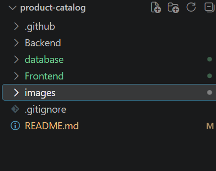
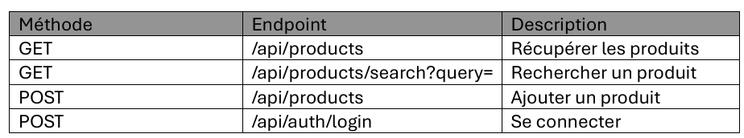
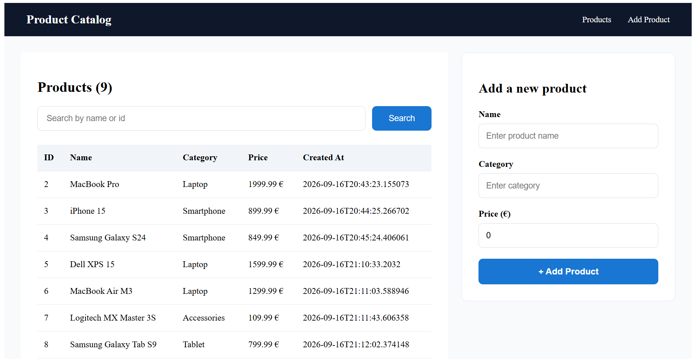

# Product Catalog

##  Description

Product Catalog est une application Web permettant de consulter, rechercher et ajouter des produits.

L'application est composée d'un frontend Angular et d'une API REST développée avec Spring Boot. Les données sont stockées dans PostgreSQL.

### Fonctionnalités

- Affichage de la liste des produits
- Recherche par nom ou identifiant
- Ajout d'un produit
- Authentification avec JWT pour protéger l'ajout de produits

##  Technologies

- Frontend: Angular, TypeScript, HTML, CSS
- Backend: Java, Spring Boot, Spring Security, JWT
- Database: PostgreSQL
- Outils: Maven, Git, Postman

##  Choix techniques

- Spring Boot : utilisé pour développer l'API REST du backend avec une architecture en couches.
- Angular : utilisé pour développer le frontend sous forme de SPA avec des composants réutilisables.
- PostgreSQL : choisi pour assurer le stockage persistant des produits dans une base de données relationnelle.
- Spring Security + JWT : utilisés pour protéger l'ajout de produits et gérer l'authentification.

Le backend utilise une architecture en couches :

Controller → Service → Repository → PostgreSQL

Le frontend est organisé avec des composants, pages, services, modèles et un interceptor HTTP pour gérer le JWT.

Cette organisation permet de séparer les responsabilités et de faciliter la maintenance du projet.

## Structure du projet

##  Prérequis

* Java 21+
* Node.js 22.22.x
* npm
* Angular CLI 22+
* PostgreSQL

##  Installation

### A. Cloner le projet

Cloner le repository :

git clone https://github.com/ILYAS403/product-catalog.git
cd product-catalog

### B. Configuration de la base de données

L'application utilise une base PostgreSQL nommée `product_catalog`.

1. Créer la base de données :

product_catalog

2. Importer le fichier :

database/product_catalog.sql

3. La connexion est configurée dans :

Backend/src/main/resources/application.properties

Configuration par défaut :

spring.datasource.url=jdbc:postgresql://localhost:5432/product_catalog
spring.datasource.username=postgres
spring.datasource.password=postgres

 Si vos identifiants PostgreSQL sont différents, modifiez simplement `username` et `password` dans `application.properties`.

### C. Backend

Depuis le dossier `Backend` :

.\mvnw.cmd spring-boot:run

L'API est disponible sur :

http://localhost:8080

### D. Frontend

Depuis le dossier `Frontend` :

npm install
ng serve

L'application est disponible sur :

http://localhost:4200

##  Authentification

L'ajout d'un produit nécessite une authentification.

Compte valide pour tester :

Username: admin
Password: admin123

L'authentification utilise un token JWT transmis automatiquement par le frontend lors des requêtes protégées.

Si un ancien token JWT est déjà présent dans le navigateur et provoque une erreur d'authentification, il peut être supprimé depuis localStrorage.

##  API principale

##  Aperçu de l'application

##  Améliorations possibles

* Ajouter la modification et la suppression des produits
* Ajouter une gestion des utilisateurs en base de données
* Ajouter des tests unitaires et d'intégration
* Ajouter une pagination
* Améliorer la gestion des rôles et permissions

##  Auteur

Ilyas Dahir Houssien

Développeur Full-Stack

##  Licence

Ce projet a été réalisé dans le cadre d'un test technique et est destiné à un usage d'évaluation uniquement.
