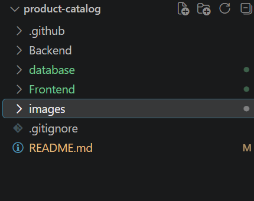
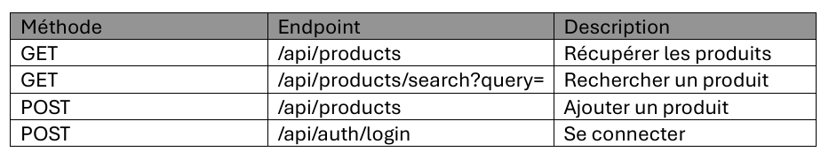
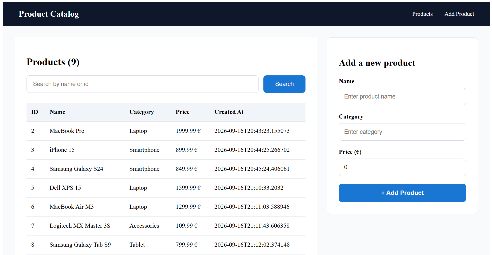

# Product Catalog

##  Description

Product Catalog est une application Web permettant de consulter, rechercher et ajouter des produits.

L'application est composée d'un frontend Angular et d'une API REST développée avec Spring Boot. Les données sont stockées dans PostgreSQL.

### Fonctionnalités

- Affichage de la liste des produits
- Recherche par nom ou identifiant
- Ajout d'un produit
- Authentification avec JWT pour protéger l'ajout de produits


##  Technologies

- Frontend: Angular, TypeScript, HTML, CSS
- Backend: Java, Spring Boot, Spring Security, JWT
- Database: PostgreSQL
- Outils: Maven, Git, Postman
- Conteneurisation: Docker et Docker Compose
- CI/CD: GitHub Actions
- Registres d'images: GitHub Container Registry (GHCR) et Azure Container Registry (ACR)
- Hébergement cloud: Microsoft Azure App Service

## CI/CD et déploiement Azure

Le projet utilise GitHub Actions pour automatiser la validation du code, la construction des images Docker, leur publication et le déploiement sur Azure.

### Chaîne d'automatisation

```text
Push ou Pull Request
        ↓
Tests backend et build frontend
        ↓
Construction des images Docker
        ↓
Publication dans GHCR et/ou ACR
        ↓
Déploiement sur Azure App Service
```

### Workflows GitHub Actions

Les workflows sont disponibles dans le dossier `.github/workflows/` :

| Workflow | Rôle |
| --- | --- |
| `ci.yml` | Exécute les tests du backend, le build du frontend et vérifie la structure du projet. |
| `docker-publish.yml` | Construit et publie les images Docker backend et frontend dans GHCR. Il génère aussi des tags selon le contexte : Pull Request, branche `main` ou release Git. |
| `deploy.yml` | Construit les images, les publie dans ACR puis déploie la version de production sur Azure lorsque du code est envoyé sur `main`. |
| `deploy-staging.yml` | Déploie une version de préproduction lorsqu'une Pull Request reçoit le label `stage`. |
| `spinup-destroy.yml` | Crée l'environnement Azure de staging avec le label `spin up environment` et le supprime avec le label `destroy environment`. |
| `github-script-automation.yml` | Automatise le traitement des Issues avec GitHub Script et les labels `bug`, `needs-triage` et `needs-review`. |

### Staging et production

- **Staging** est un environnement de préproduction utilisé pour tester l'application avant sa publication.
- **Production** est l'environnement accessible aux utilisateurs. Il est déployé automatiquement depuis la branche `main`.
- Les environnements temporaires de staging peuvent être supprimés afin d'éviter de conserver des ressources Azure inutilisées.

### Images Docker et registres

Le backend Spring Boot et le frontend Angular possèdent chacun leur propre `Dockerfile`. Docker Compose permet de lancer localement le frontend, le backend et PostgreSQL ensemble.

Les images sont publiées dans deux registres selon le besoin :

- **GHCR** (`ghcr.io/ilyas403/productcatalogue`) : publication des images dans GitHub Packages, notamment pour les Pull Requests, les branches et les releases.
- **ACR** (`acrproductcatalogilyas.azurecr.io`) : registre Azure utilisé par Azure App Service pour récupérer les images déployées.

Les tags permettent d'identifier la version d'une image, par exemple `pr-11`, `main`, `v1.0.0` ou `latest`.

### Ressources Azure

Le déploiement utilise notamment :

- un groupe de ressources Azure ;
- Azure App Service pour héberger le backend et le frontend ;
- Azure Container Registry pour stocker les images utilisées par Azure ;
- Azure Database for PostgreSQL pour les données de l'application ;
- l'authentification OIDC de GitHub Actions pour se connecter à Azure sans stocker de mot de passe dans le workflow.

Les identifiants et mots de passe nécessaires sont conservés dans les **GitHub Secrets**. Ils ne doivent jamais être écrits directement dans le code ou dans les fichiers YAML.

### Accès à la version déployée

Environnement de production :

- Frontend : https://app-productcatalog-frontend-aqdnfce9a4ezfcd8.westus3-01.azurewebsites.net
- Backend : https://app-productcatalog-backend-ckh0dsdyaba3deb5.westus3-01.azurewebsites.net

Pour déployer une nouvelle version en production, il suffit de pousser les modifications sur `main`. Le workflow `deploy.yml` lance alors les vérifications, construit les images et met à jour les applications Azure.

##  Choix techniques

- Spring Boot : utilisé pour développer l'API REST du backend avec une architecture en couches.
- Angular : utilisé pour développer le frontend sous forme de SPA avec des composants réutilisables.
- PostgreSQL : choisi pour assurer le stockage persistant des produits dans une base de données relationnelle.
- Spring Security + JWT : utilisés pour protéger l'ajout de produits et gérer l'authentification.

Le backend utilise une architecture en couches :

Controller → Service → Repository → PostgreSQL


Le frontend est organisé avec des composants, pages, services, modèles et un interceptor HTTP pour gérer le JWT.

Cette organisation permet de séparer les responsabilités et de faciliter la maintenance du projet.

## Structure du projet



##  Prérequis

* Java 21+
* Node.js 22.22.x
* npm
* Angular CLI 22+
* PostgreSQL


##  Installation

### A. Cloner le projet

Cloner le repository :


git clone https://github.com/ILYAS403/product-catalog.git
cd product-catalog

### B. Configuration de la base de données

L'application utilise une base PostgreSQL nommée `product_catalog`.

1. Créer la base de données :

product_catalog


2. Importer le fichier :


database/product_catalog.sql


3. La connexion est configurée dans :


Backend/src/main/resources/application.properties


Configuration par défaut :


spring.datasource.url=jdbc:postgresql://localhost:5432/product_catalog
spring.datasource.username=postgres
spring.datasource.password=postgres


 Si vos identifiants PostgreSQL sont différents, modifiez simplement `username` et `password` dans `application.properties`.


### C. Backend

Depuis le dossier `Backend` :


.\mvnw.cmd spring-boot:run


L'API est disponible sur :


http://localhost:8080


### D. Frontend

Depuis le dossier `Frontend` :


npm install
ng serve


L'application est disponible sur :


http://localhost:4200


##  Authentification

L'ajout d'un produit nécessite une authentification.

Compte valide pour tester :

Username: admin
Password: admin123


L'authentification utilise un token JWT transmis automatiquement par le frontend lors des requêtes protégées.

Si un ancien token JWT est déjà présent dans le navigateur et provoque une erreur d'authentification, il peut être supprimé depuis localStrorage.


##  API principale




##  Aperçu de l'application



##  Améliorations possibles

* Ajouter la modification et la suppression des produits
* Ajouter une gestion des utilisateurs en base de données
* Ajouter des tests unitaires et d'intégration
* Ajouter une pagination
* Améliorer la gestion des rôles et permissions


##  Auteur

Ilyas Dahir Houssien

Développeur Full-Stack

##  Licence

Ce projet est distribué sous licence MIT.
